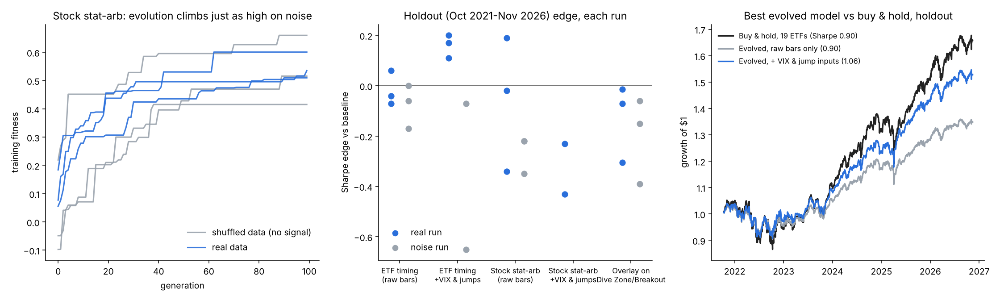
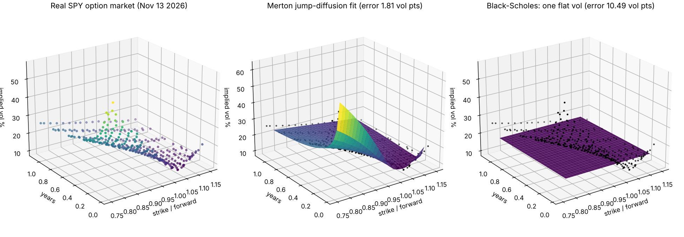

# Evolving trading strategies with NEAT, plus Merton jump-diffusion (Nov 2026)

You asked me to try something other than grid search: let evolution build trading models from raw price and volume (NEAT), and to use a Merton jump-diffusion model, a 3D volatility surface and sentiment-style data as possible confluence. This is the write-up. It is research only, and the app is unchanged.

## The short version

1. **I built NEAT from scratch and let it evolve about 412,000 trading networks on real data, plus 339,000 more on scrambled data as a control.** The networks wire themselves up from 28 raw inputs (recent returns, volume, where the close sat in the day's range, gaps, range size) and a palette of ten math functions (sin, gauss, abs, square, step, log, ...) combined by sum, product, max or min. That is about as "a human would never design this" as it gets.
2. **Raw price and volume alone gave no edge that survived the holdout.** Not for timing 19 ETFs, and not for a market-neutral long/short stock "stat-arb". The clearest proof is the control: evolution on data with the signal deliberately destroyed climbed to the same training scores, and often looked *better* in the 2017-2021 pick window. That is what overfitting looks like, and it is the trap the idea is most exposed to.
3. **The best thing evolution produced came when I gave it the VIX term structure and the Merton jump features as extra inputs.** An ensemble of three independently evolved ETF timing networks had a holdout (Oct 2021 to Nov 2026) **Sharpe of 1.06 vs 0.90 for buy-and-hold, with a smaller worst drop (-12.6% vs -17.7%)**, but a lower yearly return (9.5% vs 11.4%). All three runs beat buy-and-hold in the holdout, and the noise runs didn't. However, most of the gain came from 2025, and a bootstrap puts a 13% chance on there being no real edge. So it's promising but unproven. When I switched the inputs off one at a time, the VIX term structure did the work, and the jump features added almost nothing (1.06 to 1.05).
4. **The Merton model works well as a pricing model.** On 328 real SPY option quotes from Nov 13 2026, it fit the whole volatility surface to within **1.8 vol points**, against **10.5 for Black-Scholes**. The market prices about one **-18% crash every two years**. Two years of daily price history can't see crashes that rare, which is a big part of why selling crash insurance looks great until it doesn't (the "99% win rate" trap from the Sharpe hunt).
5. **One jump feature made a striking pattern I can't call a strategy yet.** "Only hold when jumps make up an above-normal share of recent volatility" roughly **doubled the holdout Sharpe of SPY, QQQ, Dive Zone and Breakout Rider and halved their worst drops**, but it **hurt all four from 2006 to 2021**. I only spotted it by looking at the holdout, so it breaks our pick-first rule. It's worth paper-tracking, not adding.
6. **Using evolution as an on/off overlay for Dive Zone and Breakout Rider failed.** It looked great in the pick window and cut Sharpe in the holdout (Dive Zone 1.18 to 1.07, Breakout 0.95 to 0.90). An early version even showed a fake win. A mostly-in-cash overlay got a Sharpe bonus from the T-bill yield. The noise runs showed the same "gain", which is how I caught it. All numbers here use the corrected version.

Honest bottom line: **evolution rediscovered things we already know (short-term reversal, "trade less when it's choppy", "step aside when the VIX curve inverts") instead of finding a hidden arbitrage.** It didn't beat our existing strategies. The one result worth watching is the VIX-plus-jumps ETF timing ensemble. It has lower drawdowns and a better Sharpe in the holdout, but the evidence isn't strong enough to ship it. For a resume, the strong claim is the method. A from-scratch NEAT engine with a noise-control experiment and a calibrated jump-diffusion surface is impressive *because* it reports honestly that the evolved edge mostly wasn't real.

---

## How it was tested

- **Three windows.** Evolution only ever saw **2006 to 2016** (training). In each generation, the best few networks were scored on **2017 to Oct 12 2021** (the pick window), and each run's champion is the network that did best there. **Oct 13 2021 to Nov 13 2026** (the holdout) was run once, after everything was frozen. This is the same holdout as every earlier lab.
- **No look-ahead.** Inputs are known at a day's close, and trades fill at the next open. Costs are 3 bp a side on ETFs and 5 bp on stocks. Jump features use only the trailing two years, refit weekly. A leak test checks every forward-looking line in the code.
- **Fitness rewards consistency, not one lucky stretch.** A network's score is its average Sharpe over every (asset x 4 time blocks) cell, minus half the spread between cells, minus a small charge per connection.
- **Noise control.** Every setup was also evolved on data where the link between inputs and future returns was destroyed: returns shifted in time for ETFs, shuffled between stocks each week for stat-arb. Anything those runs "find" is pure overfitting.
- **Random-network baseline.** 400 random, unevolved networks of similar size were scored on the holdout, to check whether a champion beats chance.
- **Counted tries.** About 750,900 networks were scored in training (412,100 real, 338,800 noise). About 8,300 of them were scored on the pick window, and 25 champions (plus 5 ensembles) were scored on the holdout. Separately, 96 jump-feature gates were tested.

### Data

| What | Source | Notes |
| --- | --- | --- |
| Daily OHLCV, 2004 to Nov 13 2026: 19 ETFs, 841 current and past S&P 500 / Nasdaq-100 stocks | Yahoo | Yahoo has no prices for most delisted stocks, so the stat-arb universe is point-in-time S&P members *that still have data* (about 330 a week in training). That favours long-term losers in training. |
| VIX, VIX3M, Cboe SKEW | Cboe via Yahoo | SKEW is the market's own price of tail risk |
| SPY option chain, Nov 13 2026 (22 expiries, 2 weeks to 1 year) | Yahoo snapshot | Real bid/ask mids, so it's one day only |
| Dive Zone / Breakout Rider daily returns | `research_data/growth_returns.csv` | The app's own graded series |

---

## 1. The NEAT engine (`sharkfin/neat_core.py`)

NEAT (Stanley & Miikkulainen, 2002) evolves the *wiring* of a neural network as well as its weights. Every new connection gets a global "innovation number", so two parents can be lined up gene by gene. Networks are grouped into species by how different their genes are, and each species shares its fitness. That protects new structure long enough for its weights to be tuned, because a fresh hidden node usually hurts at first.

I added two things:

- **A mixed math palette (the CPPN flavour).** Each hidden node picks its own function (identity, tanh, sin, gauss, abs, relu, square, step, signed log, x/(1+|x|)) and its own way of combining inputs (sum, product, max, min). So a network can build a threshold, a ratio, an "A and B" product or a periodic pattern on its own.
- **A feature-selective start (FS-NEAT).** Each genome starts with only two random input links and has to earn every extra input. That keeps the models small and readable.

It runs a whole population on four cores and scores each network on every (day x asset) row at once with numpy, so 35,000 networks take a few minutes. A unit test checks that it learns a product rule a linear model can't, and that it never creates a loop.

## 2. What evolution found

### A. ETF timing from raw bars: no edge

One network is shared by 19 ETFs (SPY, QQQ, IWM, DIA, MDY, nine sectors, TLT, IEF, GLD, HYG, LQD). Each evening it outputs a position from -1 to +1. The table shows the Sharpe edge over "always long" on the same data:

| Run | Train | Pick | Holdout |
| --- | --- | --- | --- |
| Seed 1 | +0.13 | +0.24 | **+0.06** |
| Seed 2 | +0.13 | +0.30 | **-0.04** |
| Seed 3 | +0.04 | +0.51 | **-0.07** |
| Noise runs (3) | -0.11 to -0.03 | +0.03 to +0.22 | -0.17 to 0.00 |

The three-seed ensemble had a holdout Sharpe of 0.90 (same as buy-and-hold), a yearly return of 8.2% vs 11.4%, and a worst drop of -15.1% vs -17.7%. In other words, it was a lower-risk version of being long, with no timing skill.

What it evolved is still neat to read. Seed 2's whole model is `tanh(-1.13*range5 + 1.24*log(r0 * R5 + 0.55) + 1.19)`. That means: stay long, trim when the last week's ranges were wide, and lean against yesterday's move when the week went the same way. That is short-term reversal plus volatility management, found without being told either exists.

### B. Stock stat-arb from raw bars: no better than noise

One network scores every S&P 500 member each week. The strategy is long the top 10% and short the bottom 10%, held a week, and market-neutral.

| | Pick Sharpe | Holdout Sharpe |
| --- | --- | --- |
| Real runs (3) | 0.20, 0.22, 0.28 | **0.19, -0.34, -0.02** |
| Noise runs (3) | 0.15, 0.16, 0.79 | -0.22, -0.35, -0.22 |
| Ensemble of the three real champions | 0.10 | **-0.23** |
| Plain 1-week reversal (for reference) | -0.28 | -0.30 |
| Random networks, 95th percentile | | -0.04 |

The left panel of the chart shows the key fact: evolution on shuffled returns climbed to training scores as high as on real returns. Weekly turnover costs eat any small cross-sectional effect, and in this universe the classic factors (reversal, momentum, low volatility) all lost money after costs from 2017 on.

### A+ and B+: with VIX term structure and jump features as inputs

I added seven "market context" inputs to the same setups. Four are about the market: SPY's day, SPY's month, VIX vs its past year, and VIX/VIX3M. Three are the Merton jump features from section 3.

| ETF timing + VIX & jumps | Train | Pick | Holdout edge |
| --- | --- | --- | --- |
| Seed 1 | +0.35 | +0.47 | **+0.11** |
| Seed 2 | +0.21 | +0.51 | **+0.17** |
| Seed 3 | +0.39 | +0.74 | **+0.20** |
| Noise runs (2) | -0.19 to -0.04 | +0.08 to +0.13 | -0.65 to -0.07 |
| Random networks, 99th percentile | | | -0.08 |

**Ensemble, holdout:** Sharpe **1.06 vs 0.90** buy-and-hold, **9.5% vs 11.4% a year**, worst drop **-12.6% vs -17.7%**, average position 0.73.

Why I don't fully trust it yet:
- **Year by year,** it tracks buy-and-hold closely except in 2025 (Sharpe 1.96 vs 1.15), the year of the April tariff crash. One good escape carries most of the edge.
- **A block bootstrap of the Sharpe difference** gives a 90% range of -0.04 to +0.37, with a 13% chance of no edge.
- **What drives it:** with the jump inputs switched off, it scored 1.05. With the VIX inputs off, it scored 0.98. All three seeds put a big negative weight on VIX/VIX3M (step aside when short-term fear exceeds 3-month fear).
- **The obvious hand rule** "hold only when VIX < VIX3M" did worse in the holdout (Sharpe 0.65-0.75), so the evolved blend is doing something beyond that rule. But it's still mostly a fear-curve filter.

The stock stat-arb with the same inputs was worse (holdout -0.43 and -0.23).

### C. Evolved exposure overlay for Dive Zone and Breakout Rider: failed

One network reads SPY's raw bars, the VIX inputs and the jump features each evening and sets tomorrow's exposure (0-100%) for both app strategies. Sharpe is on returns over T-bills:

| | Plain | Overlay (3-seed ensemble) |
| --- | --- | --- |
| Dive Zone, pick | 1.58 | 1.85 |
| Dive Zone, **holdout** | **1.18** | **1.07** |
| Breakout Rider, pick | 1.21 | 1.51 |
| Breakout Rider, **holdout** | **0.95** | **0.90** |

The noise runs scored similar pick-window "gains". **A bug I caught on the way:** the first version scored Sharpe on total return, so an overlay sitting mostly in T-bills looked like a 2+ Sharpe with almost no volatility. The noise runs found the same thing, which exposed it. Every number above uses returns over T-bills.

---

## 3. Merton jump-diffusion (`sharkfin/jump_lab.py`)

### The maths
Merton adds random jumps to Black-Scholes. Prices diffuse with volatility σ, and at rate λ a year they jump by a lognormal amount (mean μJ, spread δ). I used **SymPy** to derive the first four cumulants of the log return straight from the cumulant generating function, and compiled them to numpy:

- variance = t·(σ² + λ(μJ² + δ²))
- third cumulant = λ·t·μJ(μJ² + 3δ²)
- fourth cumulant = λ·t·(μJ⁴ + 6μJ²δ² + 3δ⁴)

**SciPy** handles the maximum-likelihood fit (a Poisson mixture of normals), the option price (Merton's series of Black-Scholes prices) and the implied-vol inversion. Tests check that it falls back to Black-Scholes when λ = 0, that it puts a downside skew on the smile, and that the fit recovers known parameters from simulated data.

### The 3D volatility surface (real SPY options, Nov 13 2026)

| Model | Error across 328 quotes (vol points) |
| --- | --- |
| Black-Scholes (one flat vol) | 10.5 |
| **Merton, 4 parameters** | **1.8** |

The fitted risk-neutral model has a diffusion vol of 11.1% plus **0.46 jumps a year averaging -18.5%** (spread 14%). That is roughly one crash of that size every two years. Fitted to the last two years of daily SPY returns, the model instead finds many small jumps (around 20 a year averaging -0.5%) and can't pin down rare large ones, because two years of daily data rarely contain one. The gap between the crash risk the market *charges* for and the crash risk recent history *shows* is the crash-insurance premium. That is why put-selling looks like free money in calm years.

### Jump features as signals
Each week I refit Merton on SPY's trailing two years and built three features:
- **jump share**: the part of variance that comes from jumps
- **jump-adjusted VRP**: VIX minus Merton's fair 30-day vol
- **skew gap**: Cboe SKEW minus the SKEW the fitted jumps imply

Then I tested 96 simple gates (3 thresholds x 2 directions x 4 features x 4 strategies), picked on 2006-2021 and graded on the holdout.

- Only 10% of gates helped in the pick window, and how much a gate helped in the pick window barely predicted how much it helped in the holdout (correlation 0.18). **No gate picked on 2006-2021 held up.**
- **The jump-adjusted VRP is a good *risk* forecaster.** Its top fifth was followed by about double the next-month volatility in both windows (29% vs 12-15% before 2021, 22% vs 12% after). It's not a return forecaster.
- **The striking pattern, which fails our rule:** "hold only when jump share is above its 1-year average" (about 58% of days):

| Excess-return Sharpe | 2006-2021 plain → gated | Holdout plain → gated | Holdout worst drop plain → gated |
| --- | --- | --- | --- |
| SPY | 0.55 → 0.49 | **0.56 → 1.21** | -24.5% → -8.9% |
| QQQ | 0.74 → 0.68 | **0.50 → 1.25** | -35.1% → -13.6% |
| Dive Zone | 1.23 → 0.91 | **1.18 → 1.67** | -22.7% → -11.5% |
| Breakout Rider | 0.80 → 0.66 | **0.95 → 1.43** | -30.6% → -15.8% |

My reading of why: when volatility is mostly *diffusion* (steady, clustered, grinding, like 2022), trends keep going down. When it's mostly *jumps* (one-off shocks), it tends to snap back. That held from 2021 to 2026 and in 2006-08, but in 2009-2018 the gate kept you out of V-shaped recoveries. I found it by looking at holdout results, so it's a hypothesis to track forward, not a strategy.

---

## What I'd do next (if anything)

1. **Paper-track two signals from today** with no changes: the VIX-plus-jumps ETF timing ensemble, and the jump-share gate on Dive Zone. A year of untouched forward data would say more than any further backtest.
2. **Point evolution at a target that *is* predictable.** Volatility and drawdown risk are much more forecastable than returns. Evolving a risk model, then sizing positions with it, is the most promising next use of NEAT here.
3. **Daily SPY option surfaces since 2024** (Alpaca, as in the Sharpe hunt) would let the Merton fit run on the risk-neutral side every day, and test whether a cheap or rich crash premium predicts anything. This snapshot is one day only.

## Code and files

- `sharkfin/neat_core.py`: the NEAT engine (speciation, innovation numbers, crossover, mixed math nodes, vectorised evaluation)
- `sharkfin/neuro_lab.py`: data, raw-bar features, the three tasks (ETF timing, stock stat-arb, overlay), noise controls, run driver (`python -m sharkfin.neuro_lab A 1 --market`)
- `sharkfin/jump_lab.py`: SymPy cumulants, MLE fit, Merton pricing, implied vols, surface calibration, rolling jump features
- `tests/test_neuro_jump_lab.py`: engine and pricing tests. `tests/test_leaks.py` allow-lists the four forward-return lines.
- Results tables: `/mnt/project-files/neuro-lab/results/` (project files)
